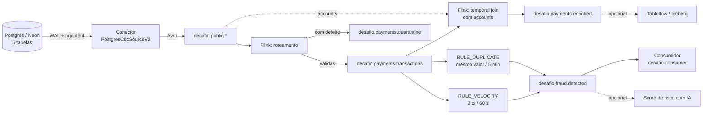

# Pipeline de pagamentos em tempo real no Confluent Cloud

Pipeline de streaming de ponta a ponta: as transações nascem em um **Postgres (Neon)**, entram no **Confluent Cloud por CDC (Debezium)**, viram tópicos **Avro** governados pelo **Schema Registry**, são enriquecidas e analisadas no **Flink SQL** e saem como **alertas de fraude** prontos para consumo.

O domínio é misto: pagamentos com cartão em que os estabelecimentos são **clientes atendidos por um BPO financeiro**. Além da regra de velocidade pedida no desafio, há uma segunda regra que pega **pagamento em dobro**, um problema clássico de conciliação.



**Reproduzível com `./setup.sh all`**, desde que o `.env` esteja preenchido a partir do `.env.example`. Para derrubar tudo: `./teardown.sh`.

## Sumário

- [Pré-requisitos](#pré-requisitos)
- [Como subir do zero](#como-subir-do-zero)
- [Camada 1: Fundação](#camada-1-fundação)
- [Camada 2: Contrato de dados](#camada-2-contrato-de-dados)
- [Camada 3: Ingestão (CDC)](#camada-3-ingestão-cdc)
- [Camada 4: Processamento (Flink SQL)](#camada-4-processamento-flink-sql)
- [Camada 5: Operação](#camada-5-operação)
- [Evoluções implementadas](#evoluções-implementadas)
- [Custo total](#custo-total)
- [Como derrubar tudo](#como-derrubar-tudo)
- [Por que cada peça](#por-que-cada-peça)
- [Problemas comuns](#problemas-comuns)

## Pré-requisitos

| Item | Para quê |
|---|---|
| Conta no [Confluent Cloud](https://confluent.cloud) | Kafka, Schema Registry, conector gerenciado e Flink |
| Conta no [Neon](https://neon.tech) (plano gratuito) | Postgres na nuvem, alcançável pelo conector gerenciado |
| [Confluent CLI](https://docs.confluent.io/confluent-cli/current/install.html) | `confluent login --save` antes de começar |
| `jq`, `psql`, `python3` (3.10+), `curl`, `timeout` | Scripts de setup, seed e evidências |
| Linux, macOS ou WSL no Windows | Os scripts são Bash |

No Neon: crie o projeto em **AWS us-east-1** (mesma região do cluster), ative **Settings > Logical Replication** e copie o host **direto** (sem `-pooler`), porque a replicação não funciona pelo pooler.

## Como subir do zero

```bash
git clone https://github.com/LuksDvs/pipeline-pagamentos-confluent.git
cd pipeline-pagamentos-confluent
cp .env.example .env              # preencha os dados do Neon
pip install -r requirements.txt
confluent login --save

./setup.sh fundacao               # Camada 1
./setup.sh contrato               # Camada 2
./setup.sh ingestao               # Camada 3
./ops/psql.sh -f scripts/demo_cdc.sql
./ops/ver_envelopes.sh
./setup.sh processamento          # Camada 4
python3 scripts/simular_fraude.py
./ops/consumir_alertas.sh
./ops/metricas.sh && ./ops/acessos.sh   # Camada 5
```

Cada camada pode ser rodada sozinha e conferida antes da próxima. Os IDs e as chaves gerados ficam no arquivo local `.state`, que está no `.gitignore`, assim como o `.env`.

---

## Camada 1: Fundação

**O que faz:** cria o environment `desafio-final` (Stream Governance Essentials), o cluster **Basic** `desafio-basic` em aws/us-east-1 e quatro identidades de serviço, cada uma com só o que precisa:

| Service account | Papel | Permissões |
|---|---|---|
| `desafio-producer` | Identidade do conector de CDC | ACL: `CREATE`, `WRITE`, `DESCRIBE` em tópicos `desafio*` e `__debezium-heartbeat*`; `IDEMPOTENT_WRITE` no cluster |
| `desafio-consumer` | Quem lê os alertas | ACL: `READ`, `DESCRIBE` em tópicos `desafio*`; `READ` em grupos `desafio*`; leitura de schemas `desafio*` |
| `desafio-flink` | Principal dos statements do Flink | RBAC: `EnvironmentAdmin` só no environment `desafio-final` (ver nota abaixo) |
| `desafio-observer` | Leitura de métricas | RBAC: `MetricsViewer` no environment |

A conta pessoal só é usada no setup e no teardown. Nenhuma aplicação usa credencial pessoal.

> **Nota sobre o Flink no cluster Basic:** o Flink não usa ACLs, só RBAC, e o cluster Basic não aceita papéis por recurso (como `DeveloperRead` num tópico). Por isso a identidade do Flink recebe `EnvironmentAdmin`, limitado ao environment do desafio. Num cluster Standard, o mínimo privilégio seria `DeveloperRead`/`DeveloperWrite` nos tópicos e subjects `desafio*` e no Transactional-Id `_confluent-flink_`.

**Evidência** (`evidencias/camada1-identidades-acls.txt`):

```text
<sua evidência aqui: saída de "confluent iam service-account list" e "confluent kafka acl list">
```

## Camada 2: Contrato de dados

**O que faz:** registra o contrato do evento de pagamento no subject `desafio.payments.contract-value`, com namespace `com.bootcamp.payments` e compatibilidade **BACKWARD**.

- Valores monetários usam `bytes` com logical type `decimal(15,2)`: nada de `float` em dinheiro.
- Campos sensíveis levam tags: `card_last4` com `PCI` e `customer_document` com `PII`.
- Os schemas estão em [`schemas/`](schemas/).

Dois testes de evolução, com resultados opostos:

| Teste | Mudança | Esperado | Motivo |
|---|---|---|---|
| `payment_event_v2_compativel.avsc` | Campo novo `installments` com `default: 1` | Compatível | O consumidor novo lê eventos antigos usando o default |
| `payment_event_v2_incompativel.avsc` | Campo novo `merchant_document` obrigatório, sem default | Incompatível | Eventos antigos não têm o campo e o consumidor novo não tem o que usar no lugar |

> Por que não testei a **remoção** de um campo? No modo BACKWARD, remover um campo é compatível: o consumidor novo só ignora o campo que vem nos eventos antigos. Quem quebra com a remoção é o modo FORWARD. O caso que de fato quebra o BACKWARD é o campo obrigatório novo sem default.

**Evidência** (`evidencias/camada2-compatibilidade.txt`):

```text
<sua evidência aqui: os dois "schema compatibility validate", um true e um false>
```

## Camada 3: Ingestão (CDC)

**O que faz:** cria as tabelas no Postgres, o usuário `cdc_user`, a publicação e carrega os dados sintéticos; depois liga o conector **PostgresCdcSourceV2**.

- **Privilégio mínimo:** `cdc_user` tem `LOGIN REPLICATION`, `CONNECT` e `SELECT` nas cinco tabelas. Não escreve nada ([`db/02_cdc_user.sql`](db/02_cdc_user.sql)).
- **`REPLICA IDENTITY FULL`** em todas as tabelas, para o `UPDATE` e o `DELETE` trazerem a linha inteira em `before`.
- **Publicação criada à mão** (`publication.autocreate.mode=disabled`), assim o usuário de CDC não precisa ser dono das tabelas.
- **`heartbeat.interval.ms=60000`:** mantém o slot avançando mesmo sem alterações, para o Postgres não acumular WAL.
- **`time.precision.mode=connect`** e **`decimal.handling.mode=precise`:** datas chegam como timestamp e valores como decimal exato.
- **`errors.tolerance=all`:** um registro problemático não derruba o conector (ver quarentena na Camada 4).
- A configuração está em [`connectors/cdc.json`](connectors/cdc.json), **sem segredos**: as credenciais entram por variáveis na hora do setup, e o arquivo preenchido é apagado em seguida.

**Seed determinístico (seed=42):**

| Tabela | Linhas |
|---|---|
| customers | 200 |
| accounts | 240 |
| cards | 320 |
| merchants | 60 |
| transactions | 2000 |

Entre as 2000 transações, o seed planta de propósito **8 rajadas de velocidade**, **5 pagamentos duplicados** e **5 eventos com defeito**. Ele também calcula quantos alertas o Flink deve gerar, o que serve de gabarito para a Camada 4.

**Os três tipos de evento** (`scripts/demo_cdc.sql` faz um insert, um update e um delete em `merchants`):

| Operação | `op` | `before` | `after` |
|---|---|---|---|
| INSERT | `c` | nulo | linha nova |
| UPDATE | `u` | linha antiga (graças ao `REPLICA IDENTITY FULL`) | linha nova |
| DELETE | `d` | linha apagada | nulo, seguido de um **tombstone** (valor nulo) |

**Evidência** (`evidencias/01-envelopes-cdc.json`, gerado por `./ops/ver_envelopes.sh`):

```json
<sua evidência aqui: os envelopes op=c, op=u, op=d e o tombstone da Padaria Demonstração CDC>
```

## Camada 4: Processamento (Flink SQL)

**O que faz:** onze statements em [`sql/`](sql/), um por arquivo, executados em ordem pelo `setup.sh`.

| Arquivo | O que faz |
|---|---|
| `01` | Lê o envelope do tópico de transações como **append-only** (transação é um fato que só é inserido) |
| `02`, `03` | Chave primária e watermark (`updated_at`) em `accounts`: vira uma **tabela versionada** |
| `04`, `05`, `06` | Um statement set separa transações **válidas** de **com defeito** (quarentena) |
| `07`, `08` | **Temporal join:** cada transação recebe a versão da conta vigente **no momento da transação** |
| `09`, `10` | **RULE_VELOCITY** com `MATCH_RECOGNIZE`: 3 transações no mesmo cartão em até 60 s, lidas das transações limpas |
| `11` | **RULE_DUPLICATE** com `MATCH_RECOGNIZE`: mesmo cartão, mesmo estabelecimento e mesmo valor em até 5 min |

Escolhas importantes:

- **Tempo de evento** (`created_at`) e não tempo de processamento: o snapshot inicial chega todo de uma vez, e só o tempo de evento mantém a regra de 60 s correta.
- **Watermark de 5 s** e `sql.tables.scan.idle-timeout=5s`: a tabela de contas quase não recebe eventos, e sem o idle timeout o watermark do join ficaria preso.
- **Tópicos com 1 partição** (CDC e tabelas do Flink): sem partições ociosas segurando o watermark. Para o volume do desafio, uma partição sobra.
- **As regras leem as transações limpas, não as enriquecidas.** O temporal join emite os eventos quando o watermark da tabela de contas avança, e não na ordem do tempo. Num primeiro teste, o `MATCH_RECOGNIZE` sobre a saída do join descartou 3 dos 13 alertas do seed como atrasados. Lendo o tópico limpo, que chega na ordem do CDC, todos aparecem.
- **`alert_id` determinístico** (`VEL-<cartão>-<1ª transação>`): o consumidor consegue deduplicar o alerta se ele chegar duas vezes.

**Gabarito:** com o seed, o Flink deve gerar **8 alertas RULE_VELOCITY e 5 RULE_DUPLICATE**, com 5 eventos na quarentena. Depois de `scripts/simular_fraude.py`, os números passam para **9, 6 e 6**.

**Evidência** (`evidencias/02-alertas-fraude.json` e `evidencias/03-quarentena.json`, gerados por `./ops/consumir_alertas.sh`):

```json
<sua evidência aqui: o alerta RULE_VELOCITY do card_id 11 publicado em desafio.fraud.detected>
```

```text
<sua evidência aqui: as três transações do card_id 11 com menos de 60 s entre a primeira e a última>
```

## Camada 5: Operação

### 1. Observabilidade

`./ops/metricas.sh` consulta a Metrics API com a identidade `desafio-observer`: pico de `received_bytes` por tópico e lag máximo por consumer group.

```text
<sua evidência aqui: saída de ./ops/metricas.sh>
```

### 2. Segurança

| Identidade | Pode | Não pode | Justificativa |
|---|---|---|---|
| `desafio-producer` | Criar e escrever em `desafio*` | Ler qualquer tópico | O conector só publica; se a chave vazar, ninguém lê dados com ela |
| `desafio-consumer` | Ler `desafio*` e usar grupos `desafio*` | Escrever | Quem consome alertas não deve conseguir forjá-los |
| `desafio-flink` | Administrar o environment `desafio-final` | Nada fora desse environment | No cluster Basic o Flink só aceita papéis amplos; o isolamento fica no environment do desafio |
| `desafio-observer` | Ler métricas | Ler dados | Monitorar não exige acesso ao conteúdo |
| `cdc_user` (Postgres) | Replicar e ler 5 tabelas | Escrever no banco | Privilégio mínimo na origem |

```text
<sua evidência aqui: saída de ./ops/acessos.sh>
```

### 3. Custos

```text
<sua evidência aqui: saída de ./ops/custo.sh AAAA-MM-DD AAAA-MM-DD>
```

Duas alavancas de redução:
1. **Desligar o que não está em uso:** o conector CDC V2 é cobrado por hora de tarefa, mesmo parado sem eventos, e os statements do Flink consomem CFU enquanto rodam. O `teardown.sh` existe para isso.
2. **Juntar statements:** o roteamento válidas/quarentena roda num único statement set, e as duas regras poderiam virar um só job. Menos statements significam menos CFU.

### 4. Confiabilidade, trecho a trecho

| Trecho | Garantia | Por quê |
|---|---|---|
| Postgres → conector | Sem perda | O slot de replicação guarda a posição; se o conector cair, ele retoma do último LSN confirmado |
| Conector → Kafka | At-least-once | Em falha, o conector pode reenviar eventos; o Flink tolera porque as regras usam o `transaction_id` |
| Kafka → Flink → Kafka | Exactly-once | Checkpoints e escrita transacional do Flink no Confluent Cloud |
| Kafka → consumidor | **Elo fraco** | Depende do consumidor: commit do offset só depois de processar e deduplicação pelo `alert_id` |

## Evoluções implementadas

| Evolução | Status | Como ligar |
|---|---|---|
| Segunda regra de fraude (pagamento duplicado, 5 min) | Ligada | Já faz parte da Camada 4 |
| Evento com defeito em fila separada | Ligada | Tópico `desafio.payments.quarantine`, com o motivo da rejeição |
| Tableflow (Iceberg) | Opcional | `ENABLE_TABLEFLOW=true` no `.env` e `./setup.sh opcionais` |
| Score de risco com IA | Opcional | `ENABLE_AI_SCORE=true`, `OPENAI_API_KEY` no `.env` e `./setup.sh opcionais` |

Sobre a quarentena: o conector de CDC gerenciado é uma fonte, e a DLQ do Kafka Connect existe para conectores de destino (sink). Por isso o conector usa `errors.tolerance=all` para não parar, e a separação dos eventos com defeito (valor nulo, valor menor ou igual a zero, estabelecimento ausente) é feita no Flink.

Sobre a IA: ela pontua só os **alertas**, e não cada transação. Chamar o modelo para todas as linhas multiplicaria o custo e a latência sem necessidade.

```text
<sua evidência aqui, se ligar alguma opcional: alertas com risk_assessment ou a tabela Iceberg>
```

## Custo total

| Recurso | Tempo ligado | Custo |
|---|---|---|
| Cluster Basic | `<horas>` | `<US$>` |
| Conector PostgresCdcSourceV2 | `<horas>` | `<US$>` |
| Flink (CFU) | `<horas>` | `<US$>` |
| **Total** | | **US$ X,XX** |

## Como derrubar tudo

```bash
./teardown.sh
```

O script apaga os statements, o compute pool, o conector, o environment, as API keys e as service accounts e, por fim, **remove o slot de replicação no Postgres**: um slot sem consumidor segura o WAL e pode encher o disco do banco.

```text
<sua evidência aqui: evidencias/teardown.txt mostrando "None found." para conectores e statements>
```

## Por que cada peça

| Peça | Escolha | Alternativa descartada |
|---|---|---|
| Ingestão | **CDC** pelo WAL | Batch por consulta: perde updates intermediários, não vê deletes e carrega o banco |
| Formato | **Avro + Schema Registry** | JSON sem schema: sem contrato, sem evolução controlada |
| Cluster | **Basic** | Standard/Enterprise: SLA e rede privada que o desafio não precisa |
| Processamento | **Flink SQL** | Código próprio: mais para manter; o SQL já entrega join temporal e reconhecimento de padrão |
| Enriquecimento | **Temporal join** | Join comum: usaria a versão atual da conta, e não a vigente na hora da compra |
| Regra | **`MATCH_RECOGNIZE`** com `WITHIN` | Janela fixa de 60 s: perde rajadas que cruzam a borda da janela |
| Banco | **Neon** | Postgres local: o conector gerenciado precisa de um endereço público |

## Problemas comuns

| Sintoma | Causa provável | O que fazer |
|---|---|---|
| Conector `FAILED` com erro de replicação | Replicação lógica desligada ou host com `-pooler` | Ative em Settings > Logical Replication e use o host direto |
| `permission denied to create role` no Neon | O papel não pode criar usuário com `REPLICATION` | Crie o `cdc_user` pelo console do Neon e rode só os `GRANT` de `db/02_cdc_user.sql` |
| Statement `02` falha dizendo que a chave já existe | O Flink já inferiu a chave a partir da key do tópico | Pode ignorar |
| Statement `01` recusado | O Flink não aceitou reler o envelope como append | Rode `SHOW CREATE TABLE \`desafio.public.transactions\`` e confira o `value.format` inferido |
| Nenhum alerta aparece | Watermark parado | Rode `scripts/simular_fraude.py` até o fim: o último insert existe para avançar o watermark |
| Custo continua depois do teste | Recurso esquecido | Rode `./teardown.sh` e confira no console |
